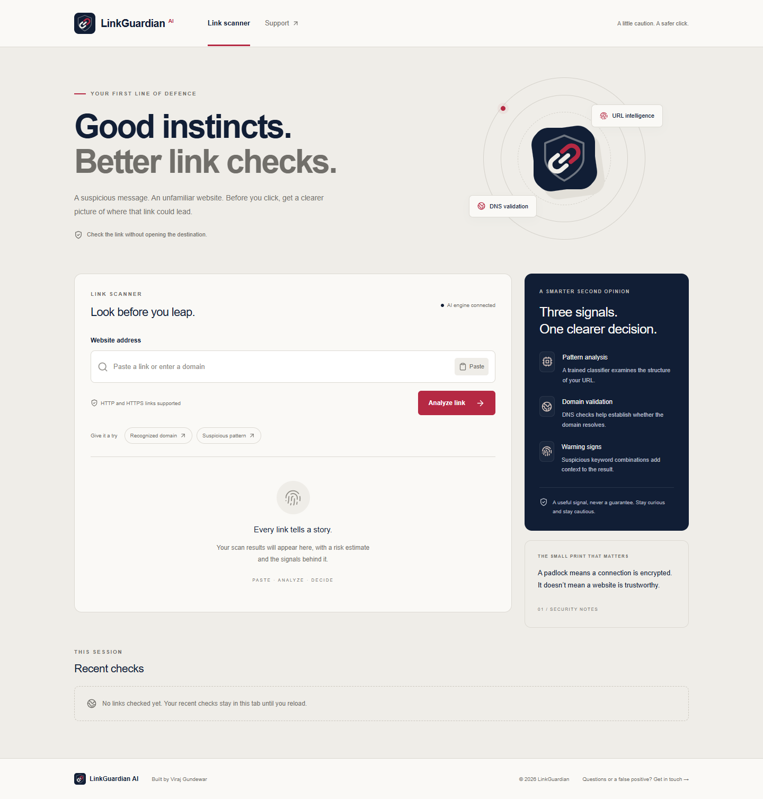
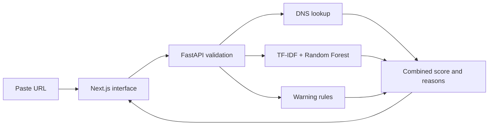

# LinkGuardian AI

**Check suspicious links before opening them.** LinkGuardian is a URL risk scanner that combines a trained Random Forest model, DNS checks, and warning rules in an accessible web interface.

Built by **Viraj Gundewar**.

**Live website:** [linkguardian-ai-pi.vercel.app](https://linkguardian-ai-pi.vercel.app) · **API health:** [linkguardian-api.vercel.app/health](https://linkguardian-api.vercel.app/health) · **Source:** [viraj2510/linkguardian-ai](https://github.com/viraj2510/linkguardian-ai)



## What problem does it solve?

Phishing messages impersonate familiar brands, promise rewards, or ask people to verify accounts. A convincing-looking link can lead somewhere unexpected. HTTPS encrypts a connection but does not establish whether a website is trustworthy.

LinkGuardian gives users a second opinion before sharing passwords or payment details. Paste an address to get a risk estimate and an explanation without opening the destination in your browser. This is an educational screening tool; it cannot certify that a website is safe.

## Features

- Scan HTTP/HTTPS URLs and bare domains such as `google.com`.
- See a risk score, risk label, DNS status, model availability, and written reasons.
- Try recognized-domain and suspicious-pattern examples.
- Review the five most recent unique scans in the current tab and clear the history.
- Use a responsive desktop and mobile interface.
- Read the support FAQ or prepare an email draft using the contact form.
- Run inference from the bundled model without a paid AI API key.

## How it works



1. **Validate:** Trim input, add HTTPS when absent, and normalize the hostname. Reject unsupported protocols, embedded credentials, invalid domains, control characters, and private IP literals.
2. **Check DNS:** Look for A records and, when appropriate, AAAA records. Distinguish missing domains from inconclusive lookups.
3. **Analyze patterns:** A saved pipeline transforms URL text using character n-grams (3–5) and word n-grams (1–2) with TF-IDF, then applies a 300-tree Random Forest classifier.
4. **Combine signals:** Recognized domains can reduce risk; suspicious combinations such as `wallet-connect` or `bypass-otp` increase it. User-hosted subdomains do not automatically inherit trust.
5. **Explain:** Return the score, label, DNS status, and reasons. If model loading fails, explicitly report limited heuristic analysis.

| Score | Label | Meaning |
| --- | --- | --- |
| 0–34 | LOW RISK | No strong warning signals were found by these checks |
| 35–64 | CAUTION | Some checks raised concerns or were inconclusive |
| 65–100 | HIGH RISK | Strong warning patterns were detected |

Suspicious keyword combinations set a minimum score of 85. Missing DNS sets a minimum of 50; inconclusive DNS or an unavailable model sets a minimum of 40. DNS failure alone does not prove fraud. Scores are estimates, not calibrated probabilities.

## Technology

| Layer | Tools |
| --- | --- |
| Frontend | Next.js Pages Router, React, TypeScript, Tailwind CSS, Lucide icons |
| API | Python 3.12, FastAPI, Pydantic, Uvicorn |
| AI model | scikit-learn, TF-IDF, Random Forest, joblib |
| Data and DNS | pandas, requests, dnspython |
| Testing | unittest, FastAPI TestClient, Playwright with Microsoft Edge |
| Deployment | Two Vercel projects; optional local Docker Compose |

## Project structure

```text
backend/
  app/main.py             API, validation, health, CORS
  app/model.py            Training, inference, DNS and scoring
  app/utils.py            Explicit OpenPhish feed download
  app/rf_model.joblib      Saved inference pipeline
  test_backend.py         Backend regression checks
  index.py                Vercel entry point
  requirements.txt        Python dependencies
frontend/
  pages/                  Scanner and support pages
  components/             Shared UI components
  styles/globals.css      Responsive design
  public/                 Brand assets
  browser-check.cjs       Production browser checks
  package-lock.json       Reproducible frontend dependencies
docs/
  DEPLOYMENT.md           Vercel setup and troubleshooting
  LinkGuardian_Project_Documentation.docx
docker-compose.yml
```

## Run locally

Install Node.js 20.9+ and Python 3.12. From the project root, create an environment and start the API:

```powershell
python -m venv .venv
.\.venv\Scripts\Activate.ps1
python -m pip install -r backend/requirements.txt
python -m uvicorn backend.app.main:app --host 127.0.0.1 --port 8000
```

In a second terminal:

```powershell
npm --prefix frontend ci
Copy-Item frontend/.env.example frontend/.env.local
npm run dev
```

Open [localhost:3000](http://localhost:3000). API documentation is at [localhost:8000/docs](http://localhost:8000/docs); model status is at [localhost:8000/health](http://localhost:8000/health).

For a production frontend locally, run `npm run build`, then `npm start`.

### Environment variables

| Variable | Service | Purpose |
| --- | --- | --- |
| `NEXT_PUBLIC_API_URL` | Frontend | API origin; defaults to `http://localhost:8000` |
| `CORS_ORIGINS` | API | Comma-separated allowed browser origins; defaults to localhost and 127.0.0.1 on port 3000 |

The public API URL is embedded at build time: rebuild after changing it. Restart/redeploy the API after changing CORS. Never put secrets in `NEXT_PUBLIC_*` variables or commit environment files.

### Docker alternative

```sh
docker compose up --build
```

The included Docker settings target local ports 3000 and 8000. For remote hosting, configure the frontend API URL at build time and the API's exact allowed frontend origin.

## API reference

### GET /health

```json
{"status":"ok","model_available":true}
```

When the model cannot load, HTTP status is still 200 but the body reports `status: "degraded"` and `model_available: false`. Inspect the body when checking readiness.

### POST /predict

Request:

```json
{"url":"google.com"}
```

Example response shape (actual scores and DNS results depend on the checks):

```json
{
  "url": "https://google.com",
  "is_malicious": false,
  "domain_exists": true,
  "risk_score": 15,
  "risk_level": "LOW RISK",
  "reason": "The hostname matches a recognized domain; this does not verify the page content.",
  "model_available": true
}
```

Invalid input returns HTTP 422. Unexpected analysis failures return HTTP 503 with a generic message. Input is limited to 4,096 characters. `domain_exists` may be true, false, or null for an inconclusive lookup.

## Testing

Activate the Python environment and install `httpx` for the API test client if needed:

```sh
python -m pip install httpx
npm run test:backend
npm run build
```

The 9 backend tests cover normalization, invalid URLs, domain trust boundaries, DNS uncertainty, keyword rules, model fallback, API validation, and sanitized errors.

For browser checks, start the backend with the test frontend origin allowed:

```powershell
$env:CORS_ORIGINS='http://localhost:3001'
python -m uvicorn backend.app.main:app --host 127.0.0.1 --port 8000
```

Start the built frontend in another terminal:

```sh
npm --prefix frontend run start -- -p 3001
```

Then run `npm run test:browser`. It uses installed Microsoft Edge on Windows and checks live health, a low-risk scan, invalid input, a suspicious scan, recent results, support navigation, FAQ expansion, desktop/mobile overflow, and browser runtime errors. Screenshots are saved as `frontend/preview-*.png`. Set `BROWSER_TEST_URL` to check a public deployment.

Passing application tests does not establish real-world phishing detection accuracy.

## Deploy for free on Vercel

Follow [the deployment guide](docs/DEPLOYMENT.md). Import this repository as two projects on the eligible free Hobby plan:

1. **API:** Root Directory `backend`, FastAPI detection, Python 3.12. Verify `/health` reports a loaded model.
2. **Frontend:** Root Directory `frontend`, Next.js preset, `NEXT_PUBLIC_API_URL` set to the deployed API origin before building.
3. Set API `CORS_ORIGINS` to the exact frontend origin, then redeploy the API.
4. Verify live scans and mobile layouts before sharing the link.

Both services are required. Free quotas, cold starts, DNS availability, and function bundle limits still apply. Deployment URLs should be recorded only after successful deployment and public verification.

## Training and model updates

Training combines an explicitly downloaded OpenPhish feed, synthetic malicious examples, and a small generated benign sample from recognized domains. Training uses a fixed random seed of 42. There is no continuous feed synchronization.

To refresh the feed and replace the model locally:

```sh
python -c "from backend.app.utils import download_openphish_dataset; from backend.app.model import train_model; train_model(download_openphish_dataset())"
```

Evaluate the replacement on independent, representative data before deployment. Commit the evaluated artifact and restart/redeploy the API. Do not train inside serverless requests. Only load trusted joblib artifacts: deserialization can execute code.

## Limitations and privacy

- Analysis covers URL text and DNS. It does not fetch page content, follow redirects, inspect downloads, or detect every scam.
- No held-out accuracy, precision, recall, or false-positive rate is claimed. The benign sample is narrow and can bias predictions.
- Recognized domains may contain compromised pages. A low score never guarantees safety.
- DNS availability varies across environments; uncertainty is reported explicitly.
- Submitted URLs go to the API. Avoid URLs with private tokens or confidential query parameters. DNS queries disclose hostnames to the configured resolver.
- The application has no scan database. Recent results live in the current tab and disappear on reload. Hosting providers may retain operational logs under their policies.
- The support form opens a `mailto:` draft; it does not send email or store requests.
- This version has no user authentication, application-level rate limiting, or abuse prevention. Consider those needs before expanding to a high-traffic public service.

## Documentation and contact

The [Word project report](docs/LinkGuardian_Project_Documentation.docx) contains project background and architecture. This README and the deployment guide describe the current executable setup.

Contact: [viraj.gundewar1995@gmail.com](mailto:viraj.gundewar1995@gmail.com).

No open-source license has been selected. Add a suitable license before granting reuse rights.
